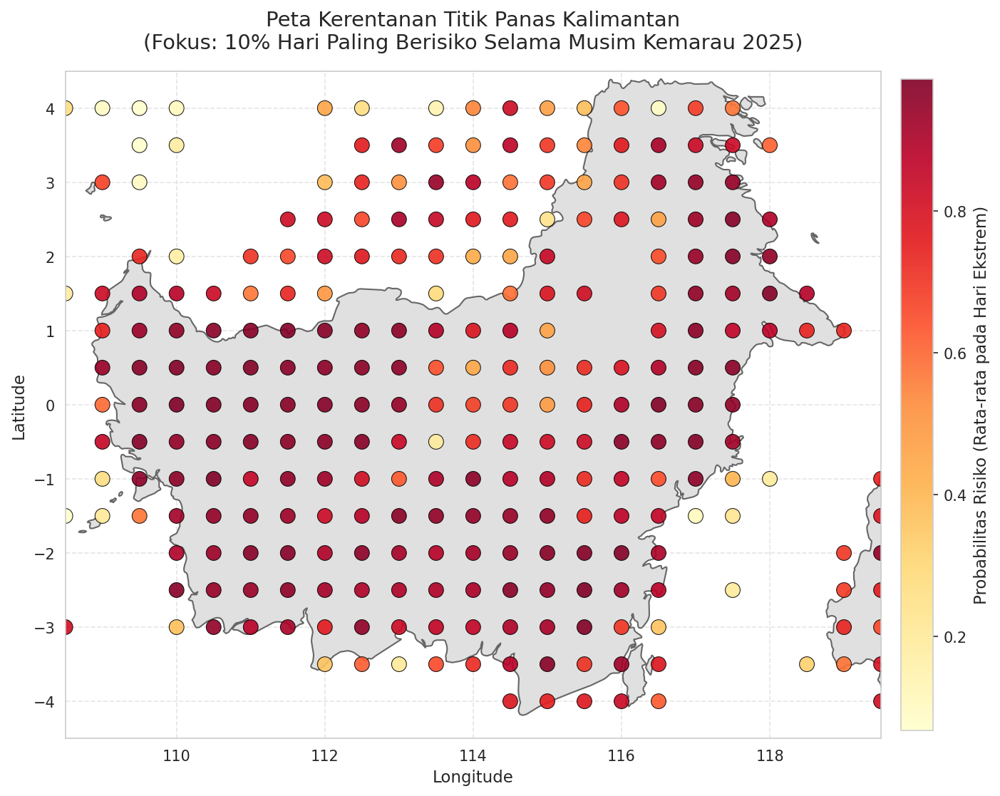
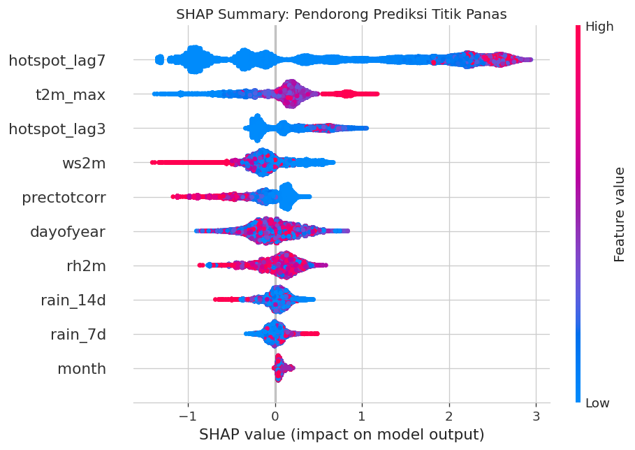
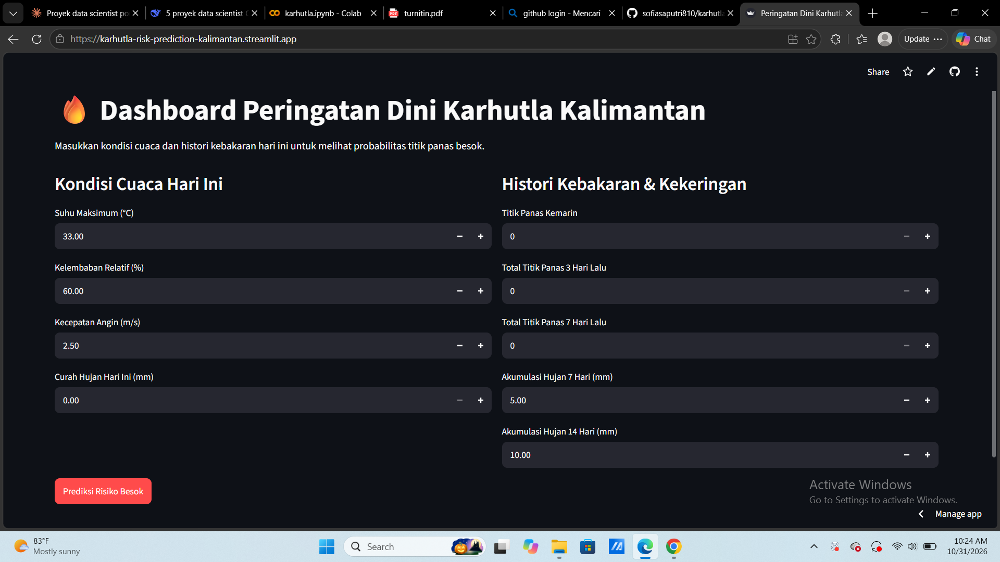

# Prediksi Risiko Titik Panas Karhutla Kalimantan Berdasarkan Akumulasi Cuaca dan Historis Kebakaran

## Preview

## 📌 Ringkasan Eksekutif
Proyek ini membangun model machine learning untuk memprediksi probabilitas kemunculan titik panas (hotspot) kebakaran hutan dan lahan (karhutla) di Kalimantan pada hari berikutnya (H+1). Menggunakan data satelit NASA FIRMS dan data cuaca NASA POWER, model menganalisis bagaimana kekeringan jangka panjang dan keberlanjutan api (persistence) memengaruhi risiko kebakaran di masa depan.

Hasil Utama:
- Model XGBoost mencapai PR-AUC sebesar 0.8502 pada data uji (Agustus–Oktober 2026), mengungguli baseline Logistic Regression (PR-AUC: 0.8298).
- Dengan menggunakan threshold sensitif biaya sebesar 0.40, model mencapai Recall sebesar 90.6% dan Precision 69.2%. Artinya, model berhasil menangkap lebih dari 90% kejadian kebakaran aktual, sangat ideal untuk skenario peringatan dini.
- Analisis SHAP mengungkap bahwa keberlanjutan historis kebakaran (`hotspot_lag7`) dan cuaca ekstrem (`t2m_max` & `rh2m`) adalah prediktor utama risiko karhutla esok hari.

---

## 🎯 Latar Belakang Masalah
Kebakaran hutan dan lahan di Kalimantan merupakan bencana tahunan yang berdampak pada kesehatan, ekonomi, dan lingkungan. Cuaca ekstrem (kemarau panjang) dan lahan gambut yang mengering menjadi pemicu utama api mudah menyebar dan bertahan lama. 

Pertanyaan analitis yang ingin dijawab:
> "Berdasarkan kondisi cuaca makro dan histori keberadaan titik panas, di grid mana dan pada hari apa risiko kemunculan titik panas tertinggi?"

---

## 📊 Data & Metodologi

### 1. Sumber Data (Publik & Gratis)
- NASA FIRMS (VIIRS): Data titik panas harian wilayah Kalimantan (Bujur 108°–120°BT, Lintang 4°LS–4°LU).
- NASA POWER: Data cuaca harian (Suhu maksimum, kelembaban relatif, kecepatan angin, curah hujan) pada grid yang sama.

### 2. Rekayasa Fitur (Feature Engineering)
- Spatial Aggregation: Titik panas diagregasi ke dalam grid 0.5° × 0.5° untuk setiap harinya.
- Lag Features: Menghitung jumlah titik panas 1, 3, dan 7 hari terakhir (`hotspot_lag1`, `lag3`, `lag7`) untuk menangkap pola *persistence* (api yang terus menyala).
- Weather Accumulation: Akumulasi curah hujan 7 dan 14 hari terakhir (`rain_7d`, `rain_14d`) sebagai indikator tingkat kekeringan lahan gambut.
- Target: Klasifikasi biner (1 jika besok muncul ≥1 titik panas di grid tersebut, 0 jika tidak).

### 3. Strategi Validasi (Strictly Time-Based Split)
Kami tidak menggunakan random split karena akan menyebabkan data leakage (model melihat data masa depan).
- Train: Juli 2026 – 15 Agustus 2026
- Test: 16 Agustus 2026 – Oktober 2026 (Puncak musim kemarau, di mana risiko paling tinggi).

### 4. Pemodelan & Evaluasi
- Baseline: Logistic Regression (dengan `class_weight='balanced'`).
- Model Utama: XGBoost Classifier (`scale_pos_weight` disesuaikan untuk ketidakseimbangan kelas).
- Metrik Evaluasi: PR-AUC (Average Precision). Metrik ini dipilih karena dataset sangat tidak seimbang. Kami sengaja tidak menggunakan Accuracy agar tidak tertipu oleh model yang hanya menebak "tidak ada kebakaran" terus-menerus.

---

## 💡 Temuan Kunci & Interpretasi

### A. Analisis SHAP: Apa Pemicu Utama?
Berdasarkan nilai SHAP (SHapley Additive exPlanations), 3 fitur paling berpengaruh adalah:
1. `hotspot_lag7` (Historis 7 Hari): Model sangat bergantung pada keberlanjutan (persistence) api. Jika api sudah menyala dalam seminggu terakhir, probabilitasnya sangat tinggi untuk berlanjut.
2. `t2m_max` (Suhu Maksimum): Suhu yang lebih tinggi mendorong risiko lebih tinggi.
3. `rh2m` (Kelembaban): Kelembaban tinggi menekan risiko kebakaran.

Catatan Analitis: Dominasi fitur lag menunjukkan model ini sangat baik memprediksi *keberlanjutan* kebakaran. Namun, model ini belum dilengkapi dengan fitur aktivitas manusia (seperti jarak ke jalan atau batas konsesi), yang menurut literatur juga menjadi pemicu utama titik api baru (new ignition).

### B. Peta Kerentanan Spasial
(Lihat: `risk_map_final.png`)
Kami memfilter 10% hari paling berisiko (puncak musim kemarau) untuk melihat wilayah mana yang paling rentan. Hasilnya menunjukkan konsentrasi risiko tertinggi di wilayah Kalimantan Barat dan Kalimantan Tengah (terutama area gambut di bagian barat dan selatan). 

### C. Analisis Sensitivitas Biaya (Cost-Sensitive Analysis)
Dalam skenario mitigasi bencana, melewatkan potensi kebakaran (False Negative) jauh lebih berbahaya daripada mengirim patroli ke lokasi yang ternyata aman (False Positive). Dengan mengasumsikan biaya FN = 3x biaya FP, kami menurunkan threshold keputusan dari default 0.5 menjadi 0.40. Ini meningkatkan Recall menjadi 90.6% — artinya model berhasil menangkap hampir seluruh kejadian kebakaran aktual, dengan kompensasi Precision sebesar 69.2%.

---

## ⚠️ Keterbatasan (Limitations)
1. Ketiadaan Fitur Aktivitas Manusia: Model saat ini hanya menggunakan data cuaca dan histori satelit. Faktor pemicu api akibat ulah manusia belum dimasukkan karena keterbatasan data vektor batas konsesi yang terbuka.
2. Satelit tidak sempurna: Data titik panas NASA FIRMS bisa mengalami *false positive* dan *under-detection* akibat tutupan awan.
3. Agregasi Grid: Penggunaan grid 0.5° membuat titik koordinat di pesisir bisa "bocor" ke laut atau wilayah negara tetangga sebelum proses *spatial clipping*.

## 🚀 Cara Menjalankan (Reproducibility)
1. Clone repo ini.
2. Buka notebook di Google Colab.
3. Daftarkan API Key gratis dari [NASA FIRMS](https://firms.modaps.eosdis.nasa.gov/api/map_key/).
4. Simpan API Key sebagai environment variable: `os.environ["FIRMS_MAP_KEY"] = "key_kamu"`.
5. Jalankan sel secara berurutan (Runtime > Run All).

---
> "Dari data satelit yang rumit menjadi peta peringatan dini: mari gunakan Machine Learning untuk mengalokasikan sumber daya pemadaman karhutla secara lebih presisi dan tepat waktu."

Anda juga bisa mengakses website peringatan dini sederhana berikut [https://karhutla-risk-prediction-kalimantan.streamlit.app/]

Dibuat oleh: Sofia Saputri
